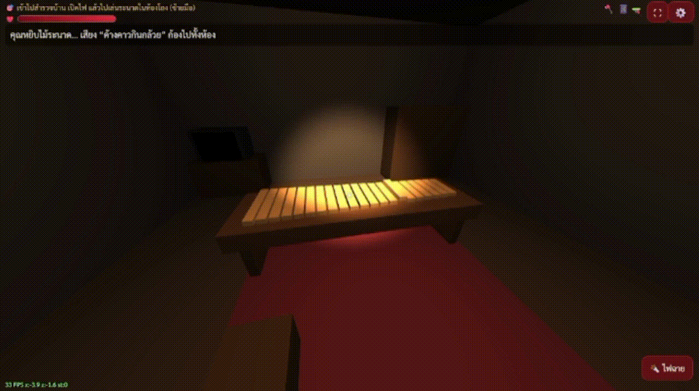

# 🦇 ค้างคาวกินกล้วย — บ้านระนาดผี (Khang Khao Kin Kluai - The Haunted Ranad House)

👉 **เล่นเกมออนไลน์:** https://khaangkhaawkinklwy-baanranaadphii.onrender.com/
📦 **ที่เก็บโปรเจกต์ GitHub:** https://github.com/iscursordub-star/khangkhaawkinklwy-nightmare/tree/main

> **Note:** ต้องเปิดโหมด **Override software rendering list** เพราะถ้าเล่นแบบเปล่าๆ จะทำให้เกิดอาการ FPS ตกได้

**หากคุณใช้ Chrome ให้ทำตามขั้นตอนนี้**
> **ขั้นตอนที่ 1.** ไปที่ `chrome://flags`

> **ขั้นตอนที่ 2.** ค้นหา `Override software rendering list`

> **ขั้นตอนที่ 3.** เปลี่ยนจาก **Disabled** เป็น **Enabled** แล้วกด **Relaunch**

**หากคุณใช้ Edge, Brave หรือ Opera ให้ทำตามขั้นตอนนี้**
> **ขั้นตอนที่ 1.** ไปที่ `"ชื่อเบราว์เซอร์ของคุณ"://flags` (เช่น `edge://flags`, `brave://flags`, `opera://flags`)

> **ขั้นตอนที่ 2.** ค้นหา `Override software rendering list`

> **ขั้นตอนที่ 3.** เปลี่ยนจาก **Disabled** เป็น **Enabled** แล้วกด **Relaunch**

**หากคุณใช้ Mozilla Firefox เบราว์เซอร์นี้จะแตกต่างจาก Chrome, Edge, Brave, Opera แต่สามารถตั้งค่าได้ตามขั้นตอนนี้**
> **ขั้นตอนที่ 1.** เปิดเมนูด้านขวาบนแล้วไปที่ **Settings** (การตั้งค่า)

> **ขั้นตอนที่ 2.** เลื่อนลงไปที่ส่วน **Performance** (ประสิทธิภาพ)

> **ขั้นตอนที่ 3.** เอาเครื่องหมายถูกหน้า **Use recommended performance settings** ออก แล้วติ๊กถูกที่ **Use hardware acceleration when available**

---

## 📜 เรื่องย่อและบรรยากาศของเกม
"ค้างคาวกินกล้วย" เป็นบทเพลงไทยเดิมที่มีทำนองสนุกสนานและคุ้นหู แต่ในค่ำคืนนี้ ณ บ้านไม้โบราณของครูระนาดผู้ล่วงลับ กลับเต็มไปด้วยความเงียบงัดและบรรยากาศอันน่าสะพรึงกลัว...

คุณรับจ้างเฝ้าบ้านเก่าของครูระนาดผู้ล่วงลับ คืนนี้ฟ้ามืดสนิทและไฟในบ้านเกิดดับลงเกือบทั้งหมด มีเพียงแสงจันทร์สลัวและแสงไฟฉายในมือที่จะช่วยนำทางคุณ ท่ามกลางความเงียบงัน เสียงลมพัดผ่านหน้าต่างคล้ายเสียงกึกก้องของปีกค้างคาว และเสียงบรรเลงระนาดทุ้มต่ำที่ดังแว่วมาจากมุมมืดอย่างไร้ที่มา—มันคือบทเพลงที่ถูกเล่นซ้ำไปซ้ำมา... โดยไม่มีวันจบ

---

## 🎮 ข้อมูลหน้าจอและระบบควบคุม (UI & Controls)

### ข้อความสถานะระบบ
* **ชื่อเกม:** ค้างคาวกินกล้วย — บ้านระนาดผี (Khang Khao Kin Kluai - The Haunted Ranad House)
* **หน้าโหลดเกม:** กำลังโหลดทรัพย์สินเกม... (Loading assets...)
* **หน้าเริ่มเกม:** กดเพื่อเริ่มเกม (Click to Start)
* **หน้าจอมือถือ:** กรุณาหมุนจอเป็นแนวนอน เพื่อเล่นเกมนี้
* **เมนูตั้งค่า / หยุดเกม:** การตั้งค่า (เกมหยุดอยู่) — กด `Esc` เพื่อปล่อยเมาส์หรือเปิดตั้งค่า
* **แถบคำแนะนำบนหน้าจอ:** คลิกที่หน้าจอเพื่อล็อคเมาส์ · WASD เดิน · E / คลิกซ้าย โต้ตอบ · F ไฟฉาย · Esc หยุด/ตั้งค่า

### ปุ่มควบคุมและการโต้ตอบ
* **เดิน (Movement):** ปุ่ม `W`, `A`, `S`, `D` (คอมพิวเตอร์) หรือจอยสติ๊กมุมซ้ายล่าง (มือถือ)
* **หันมุมมอง (Look Around):** ขยับเมาส์ (คลิกที่หน้าจอเพื่อล็อคเมาส์ไว้กลางจอ และกด `Esc` เพื่อปล่อย/ตั้งค่า) หรือลากนิ้วบนหน้าจอ (มือถือ)
* **โต้ตอบ / เปิด (Interact / Open):** เล็งจุดกลางจอแล้วกด `E` หรือ **คลิกซ้าย** (บนมือถือใช้ปุ่มสีแดงบนจอ) เพื่อเปิด-ปิดประตู, กดสวิตช์เปิดไฟตามห้อง, ไขกุญแจ หรือหยิบไอเทมสำคัญ
* **ไฟฉาย (Flashlight):** กด `F` เพื่อเปิดหรือปิดไฟฉาย
* **วิ่ง (Sprint):** กด `Shift` ค้างไว้เพื่อวิ่งหนี
* **เสียง:** เปิดเสียงไว้ด้วย

---

## 📖 บทสนทนา เหตุการณ์ และเนื้อเรื่องภายในเกม (Story & Dialogue)

### 1. ฉากเปิดเรื่อง (Intro)
> "ยินดีต้อนรับสู่บ้านระนาด... เสียงดนตรีในยามวิกาลไม่ได้มีไว้ให้ความบันเทิง แต่อาจมีใครบางคนกำลังรอให้คุณไปร่วมบรรเลง"

### 2. การสำรวจบ้านและห้องโถง
* **เมื่อเดินเข้าใกล้ห้องโถง:**
  > "มีกลิ่นธูปและกลิ่นอับของไม้เก่าลอยโชยมา... เสียงระนาดดังแว่วมาจากชั้นสอง"
* **เมื่อพบประตูที่ล็อกอยู่:**
  > "ประตูบานนี้ถูกลงกลอนจากด้านใน หรือไม่ก็ต้องใช้กุญแจดอกเก่าเพื่อไขเปิดออก"
* **เมื่อเปิดสวิตช์ไฟแต่ไฟไม่ติด:**
  > "สวิตช์ไฟใช้งานไม่ได้... ดูเหมือนระบบไฟในโซนนี้จะถูกตัดขาดไปแล้ว"
* **เหตุการณ์ข้างเตียง:**
  > "ขาซีดขาวหยุดอยู่ข้างเตียง... เธอกำลังโน้มตัวลงมา คุณจะเลือกอะไร?"

### 3. เหตุการณ์ ปริศนา และมินิเกมสำคัญ
* **ตอนที่ 4 · ความลับที่ถูกซ่อนอยู่:** หนีผีและเก็บเพชรระหว่างทาง พร้อมเลือกระดับความยาก
* **ตอนที่ 5 · มัลติเพลเยอร์ (เบต้า):** โหมดเล่นร่วมกับผู้เล่นอื่นเพื่อช่วยกันเอาชีวิตรอด
* **ไขกุญแจห้องขัง:** ค้นหาและใช้กุญแจเปิดห้องขัง
* **ลูกระนาดลูกที่สิบเอ็ด:** มินิเกมตีลูกระนาดตามจังหวะบทเพลงค้างคาวกินกล้วย เพื่อสงบดวงวิญญาณของครูระนาด
* **ประตูทางออก:** ใส่รหัส 4 ตัวจากเคสเรียงตามเลขเคส (`1 → 4`)

### 4. บทสรุปและฉากจบ (Endings)
* **ฉากจบแบบไม่สมหวัง (Bad Ending):**
  > "คุณหาทางออกจากบ้านหลังนี้ไม่พบ... เสียงระนาดยังคงบรรเลงต่อไปอย่างไม่รู้จบ และคุณได้กลายเป็นผู้เล่นคนใหม่ในวงระนาดไปชั่วนิรันดร์"
* **ฉากจบที่แท้จริง (True Ending):**
  > "คุณไขปริศนาทั้งหมดและหลบหนีออกมาจากบ้านระนาดผีได้สำเร็จ พร้อมกับเสียงระนาดที่ค่อยๆ เงียบสงบลงท่ามกลางแสงแรกของยามรุ่งสาง"
* **ฉากช่วงบ่าย:**
  > "บ่ายแล้ว... ชาวบ้านแยกย้ายกันไปหมด บ้านหลังนั้นยังยืนเงียบอยู่ตรงหน้าคุณ แสงแดดสะท้อนหน้าต่างบานที่เคยมีเงาค้างคาว คุณจะทำอย่างไรต่อ?"

---

## ✨ ฟีเจอร์หลักภายในตัวเกม
* **กราฟิก 3 มิติเต็มรูปแบบ:** พัฒนาด้วย HTML5, CSS, JavaScript และไลบรารี Three.js สร้างบรรยากาศบ้านไม้ไทยโบราณในความมืด
* **ระบบแสงและเงา:** ระบบไฟฉาย (`F`) และสวิตช์ไฟตามห้องที่ส่งผลต่อการมองเห็นและความปลอดภัย
* **ระบบประตูและการล็อค:** ประตูเปิด/ปิดได้ ห้องนอนล็อคจากข้างในได้ และมีปริศนาไขกุญแจห้องขัง รวมถึงรหัสประตูทางออก 4 หลัก (`1 → 4`)
* **เหตุการณ์ระทึกขวัญและปริศนา:** ระบบสุ่มเหตุการณ์หลอน ฉากเผชิญหน้า และตอนที่ 4 ที่ต้องหนีผีเก็บเพชร
* **มินิเกมดนตรีไทย:** ระบบตีลูกระนาดลูกที่สิบเอ็ดตามจังหวะเพลง
* **โหมดมัลติเพลเยอร์ (Beta):** รองรับการเล่นร่วมกันในตอนที่ 5

> **Note:** เปิดโหมด **Override software rendering list** ที่ `chrome://flags` (เปลี่ยนจาก **Disabled** เป็น **Enabled** แล้ว **Relaunch**) เพื่อลดอาการ FPS ตก

> ---
⬅️ **ย้อนกลับ / Previous:** [README.md](./README.md) | ➡️ **ไฟล์ถัดไป / Next:** [IN-GAME.md](./IN-GAME.md)

