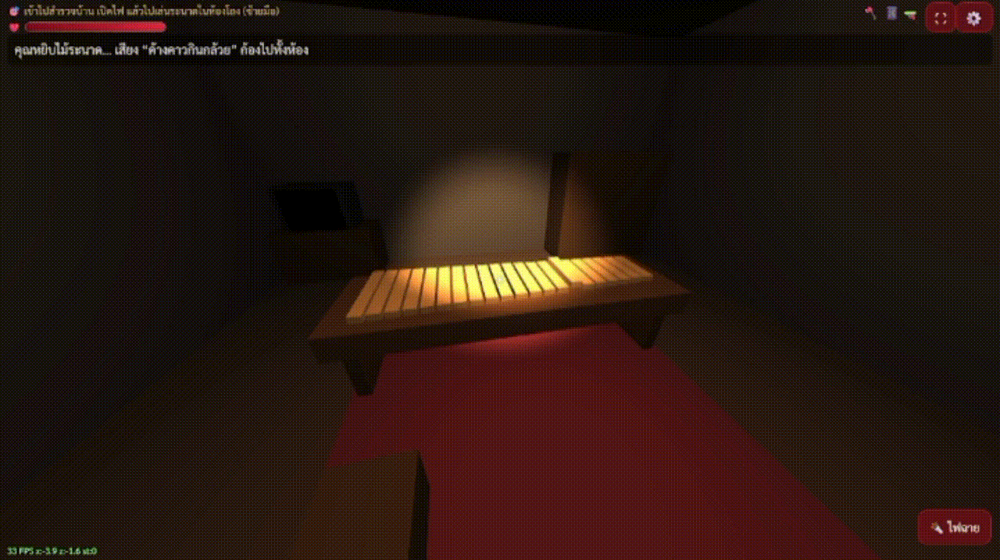
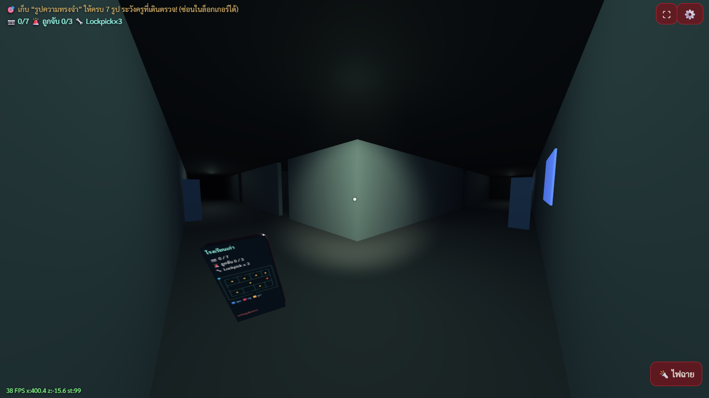
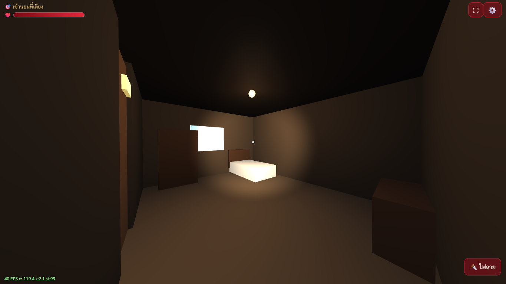
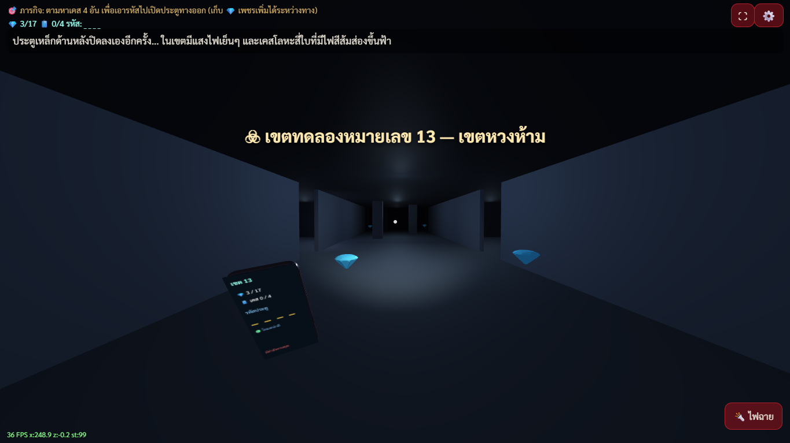

# 🦇 Khang Khao Kin Kluai — The Haunted Ranad House

👉 **Play Online:** https://khaangkhaawkinklwy-baanranaadphii.onrender.com/  
📦 **GitHub Repository:** https://github.com/iscursordub-star/khangkhaawkinklwy-nightmare/tree/main

> **Note:** You must enable **Override software rendering list** in your browser; otherwise, running the game without hardware acceleration may cause significant FPS drops.

If you using Chrome **following these Steps:**
> Step 1. Go to **chrome://flags**

> Step 2. Search for **`Override software rendering list`**

> Step 3. Change it from **Disabled** to **Enabled**, then click **Relaunch**

If you using Edge, Brave, Opera **following these Steps:**
> Step 1. Go to **"Your Browser name"://flags**

> Step 2. Search for **`Override software rendering list`**

> Step 3. Change it from **Disabled** to **Enabled**, then click **Relaunch**

If you using Mozilla Firefox this browser is different from Chrome, Edge, Brave, Opera but you can set it up by **following these Steps:**
> Step 1. Open the top-right menu and go to **Settings**

> Step 2. Scroll down to the **Performance**

> Step 3. Uncheck **Use recommended performance settings**, than check **Use hardware acceleration when available**

---

## 📜 Synopsis & Atmosphere
*"Khang Khao Kin Kluai"* (Bats Eating Bananas) is a traditional Thai classical song known for its lively and familiar melody. However, tonight at the ancient wooden house of a late Ranad (Thai xylophone) master, that melody takes on a deeply unsettling and terrifying presence...

You have been hired to watch over the old master's house overnight. Tonight is pitch-black, and nearly all the lights in the house have gone out. With only dim moonlight and a handheld flashlight to guide you, the silence is broken by wind rushing through the windows like the flapping of bat wings—and the deep, resonant sound of a Ranad playing endlessly from the shadows.

---

## 🎮 UI & Controls

### System Messages
* **Game Title:** Khang Khao Kin Kluai — The Haunted Ranad House
* **Loading Screen:** Loading assets...
* **Start Screen:** Click to Start
* **Mobile Orientation Prompt:** Please rotate your screen to landscape mode to play this game
* **Pause / Settings Menu:** Settings (Game Paused) — Press `Esc` to unlock the cursor or open settings
* **On-Screen Hint Bar:** Click screen to lock mouse · WASD Move · E / Left-Click Interact · F Flashlight · Esc Pause/Settings

### Controls & Interactions
* **Movement:** `W`, `A`, `S`, `D` keys (PC) or virtual joystick at the bottom-left corner (Mobile)
* **Look Around:** Move mouse (click screen to lock cursor, press `Esc` to release/open settings) or swipe on screen (Mobile)
* **Interact / Open:** Aim at the center reticle and press `E` or **Left-Click** (use the red on-screen button on Mobile) to open/close doors, toggle room light switches, unlock cells, or pick up key items
* **Flashlight:** Press `F` to toggle the flashlight on or off
* **Sprint:** Hold `Shift` to run
* **Audio:** Keep your sound turned on for the full experience

---

## 📖 Story & Dialogue Highlights

### 1. Intro
> "Welcome to the Ranad House... Music in the dead of night is not meant for entertainment; someone may be waiting for you to join the performance."

### 2. Exploring the House & Main Hall
* **Approaching the Main Hall:**
  > "The scent of incense and old damp wood lingers in the air... The sound of a Ranad echoes faintly from the second floor."
* **Encountering a Locked Door:**
  > "This door is bolted from the inside, or requires an old key to unlock."
* **Faulty Light Switch:**
  > "The light switch isn't working... It seems the power in this zone has been cut off."
* **Bedside Encounter:**
  > "Pale white legs stop beside the bed... She is leaning down toward you. What will you choose?"

### 3. Key Chapters, Puzzles & Minigames
* **Chapter 4 · The Hidden Secret:** Escape the ghost while collecting diamonds along the way, featuring selectable difficulty levels.
* **Chapter 5 · Multiplayer (Beta):** Co-op mode allowing you to team up with other players to survive.
* **Unlocking the Cell:** Find and use the key to unlock the prison cell door.
* **The Eleventh Ranad Bar:** A rhythm minigame where you strike the Ranad keys in time with the melody to appease the master's spirit.
* **Exit Door:** Enter the 4-digit code gathered from the cases in numerical order (`1 → 4`).

### 4. Endings
* **Bad Ending:**
  > "You failed to find a way out of the house... The Ranad continues to play endlessly, and you have become the newest performer in the ensemble for all eternity."
* **True Ending:**
  > "You solved every mystery and escaped the Haunted Ranad House as the music slowly fades into the first light of dawn."
* **Afternoon Epilogue:**
  > "It is afternoon now... The villagers have all dispersed. The house still stands silently before you, sunlight reflecting off the window where the bat's shadow once appeared. What will you do next?"

---

## ✨ Key Features
* **Full 3D Graphics:** Built with HTML5, CSS, JavaScript, and Three.js to recreate a dark, atmospheric traditional Thai wooden house.
* **Dynamic Lighting & Shadows:** Interactive flashlight (`F`) and room light switches that impact visibility and safety.
* **Doors, Locks & Codes:** Open/close doors, lock bedroom doors from the inside, unlock prison cells, and solve the 4-digit exit door code (`1 → 4`).
* **Horror Events & Chases:** Scripted scares, encounters, and diamond-collection chase sequences in Chapter 4.
* **Traditional Thai Music Minigame:** Rhythm-based Ranad performance mechanics.
* **Multiplayer Mode (Beta):** Play alongside others in Chapter 5.

> **Note:** Enable **Override software rendering list** in `chrome://flags` (switch from **Disabled** to **Enabled**, then **Relaunch**) to prevent FPS drops.
---
## Game Zones

| Zone | Preview | Objective |
| :--- | :---: | :--- |
| **Teacher's House** |  | Navigate the dark corridor and head to the bedroom at the end of the hall |
| **Hotel** |  | Explore the room and complete the objective to sleep on the bed in an eerie setting |
| **Zone 13** |  | Restricted test zone — collect gems and find 4 cases to unlock the exit |
| **School** |  | Collect 7 memory photos while avoiding patrolling teachers and hiding in lockers |

---
⬅️ **ย้อนกลับ / Previous (TH):** [WARNING.md](./WARNING.md) | ➡️ **ไฟล์ถัดไป / Next:** [IN-GAMEENG.md](./IN-GAMEENG.md)
